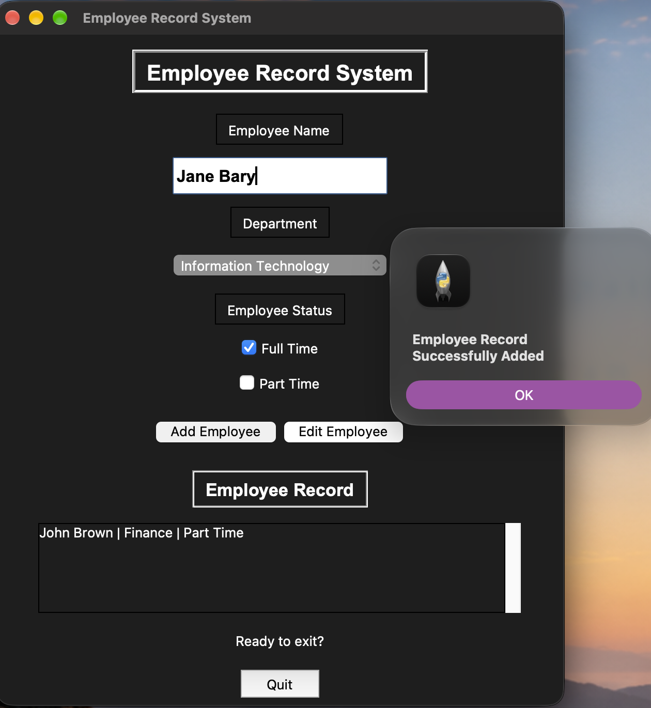

# Employee Record System

A Python desktop app built with Tkinter for managing basic employee records. You can add employees with their name, department, and employment status, view them in a scrollable list, and select any record to edit it.



## Course

**Midterm Project** – Contemporary Business Applications Development I (MIS 310)
Central Connecticut State University · Dr. Armel Djangone · Fall 2026

## Features

- **Add employees** with a name, department, and Full Time / Part Time status
- **Department dropdown** with Human Resources, Finance, Information Technology, Marketing, and Operations
- **Full Time / Part Time checkboxes** that act as a pair, so only one can be selected at a time
- **Employee list** in a scrollable listbox, shown as `Name | Department | Status`
- **Edit records** by clicking an employee in the list, which loads their info back into the form, then clicking **Edit Employee**
- **Input validation**, with error messages if the name is empty or no department is selected
- **Success messages** after adding or updating a record
- Clears the form automatically after each add or edit
- **Quit** button to close the app

## Technologies Used

| Library | Purpose |
|---|---|
| `tkinter` | GUI: window, labels, entry box, dropdown (`OptionMenu`), checkbuttons, buttons, listbox, scrollbar |
| `tkinter.messagebox` | Error and success pop-up messages |

No extra packages are needed. Tkinter comes with Python.

## How to Run

1. Install **Python 3** from [python.org](https://www.python.org/downloads/).
2. Download or clone this repository.
3. Run:
   ```bash
   python employee_record_system.py
   ```

## How to Use

1. Type the employee's name.
2. Pick a department from the dropdown.
3. Choose **Full Time** or **Part Time**.
4. Click **Add Employee**. The record appears in the Employee Record list.
5. To edit a record, click it in the list, change the details, and click **Edit Employee**.
6. Click **Quit** to close the app.

## What I Learned

- Building a GUI with Tkinter widgets and arranging them with `pack()` and frames
- Using `StringVar` and `BooleanVar` to connect widgets to data
- Storing records in a list of lists, and updating them by index
- Handling events with `<<ListboxSelect>>` to load a selected record
- Validating user input and giving feedback with message boxes
- Using `global` variables to track the selected record across functions
